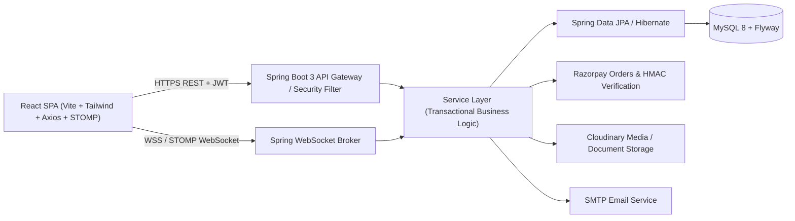

# SkillConnect — System Architecture & Development Roadmap

## 1. System Architecture Overview

SkillConnect is a full-stack, three-tier freelance marketplace platform built with a decoupled **React SPA** frontend, a **Spring Boot 3 REST & STOMP WebSocket** backend, and a **MySQL 8** relational database managed via **Flyway** migrations.



## 2. Project Folder Structure

```text
SkillConnect/
├── backend/
│   ├── pom.xml
│   ├── src/
│   │   ├── main/
│   │   │   ├── java/com/skillconnect/
│   │   │   │   ├── SkillConnectApplication.java
│   │   │   │   ├── config/          # CORS, OpenAPI, WebSocket, Async, Storage, RateLimit
│   │   │   │   ├── security/        # JwtService, JwtAuthFilter, UserDetailsServiceImpl, SecurityConfig
│   │   │   │   ├── entity/          # 23 JPA entities mapped to MySQL tables
│   │   │   │   ├── entity/enums/    # Strongly typed domain enums
│   │   │   │   ├── dto/             # Request/Response DTOs grouped by module
│   │   │   │   ├── mapper/          # Entity <-> DTO mappers
│   │   │   │   ├── repository/      # Spring Data JPA repositories & Specifications
│   │   │   │   ├── service/         # Business logic services & interfaces
│   │   │   │   ├── controller/      # REST controllers + WebSocket @MessageMapping controllers
│   │   │   │   ├── exception/       # GlobalExceptionHandler & custom domain exceptions
│   │   │   │   └── validation/      # Custom Bean Validation annotations & validators
│   │   │   └── resources/
│   │   │       ├── application.yml
│   │   │       ├── application-dev.yml
│   │   │       ├── application-prod.yml
│   │   │       └── db/migration/    # Flyway SQL migrations (V1..V4)
│   │   └── test/
│   │       ├── java/com/skillconnect/
│   │       └── resources/application-test.yml
├── frontend/
│   ├── package.json
│   ├── index.html
│   ├── tailwind.config.js
│   ├── vite.config.js
│   └── src/
│       ├── api/             # Axios client & domain API modules
│       ├── context/         # AuthContext, NotificationContext, ToastContext
│       ├── hooks/           # Custom hooks (useDebounce, useWebSocket)
│       ├── components/      # Reusable UI, layout, cards, modals, badges
│       ├── pages/
│       │   ├── public/      # Landing, About, Categories, Browse, Auth pages
│       │   ├── client/      # Client dashboard & project/contract/payment views
│       │   ├── freelancer/  # Freelancer dashboard, profile, portfolio, work, earnings
│       │   ├── admin/       # Admin analytics, users, verifications, disputes, reports
│       │   └── shared/      # Project details, Contract workspace, Real-time Chat
│       ├── routes/          # ProtectedRoute & RoleRoute guards
│       └── utils/           # Formatters, validators, constants
├── docs/
│   ├── ARCHITECTURE.md
│   └── DEPLOYMENT.md
├── .env.example
├── .gitignore
└── README.md
```

## 3. Normalized Database Schema (23 Tables)

| # | Table | Purpose & Key Relationships |
|---|-------|-----------------------------|
| 1 | `roles` | `ROLE_CLIENT`, `ROLE_FREELANCER`, `ROLE_ADMIN` |
| 2 | `users` | Core auth identity, FK `role_id -> roles(id)`, verification & reset tokens |
| 3 | `freelancer_profiles` | 1:1 with `users`, rate, bio, experience, verification & rating aggregates |
| 4 | `client_profiles` | 1:1 with `users`, company, industry, rating & spend aggregates |
| 5 | `skills` | Master skill taxonomy (`slug` unique) |
| 6 | `freelancer_skills` | M:N join between `freelancer_profiles` & `skills` with proficiency |
| 7 | `portfolio` | 1:N with `freelancer_profiles` for showcase items |
| 8 | `project_categories` | Normalized categories for projects |
| 9 | `projects` | FK `client_id -> users`, `category_id -> project_categories` |
| 10 | `project_skills` | M:N join between `projects` & `skills` |
| 11 | `project_attachments` | 1:N files attached to `projects` |
| 12 | `proposals` | Freelancer bids on `projects`, unique `(project_id, freelancer_id)` |
| 13 | `contracts` | Created from accepted proposals linking client, freelancer, project |
| 14 | `milestones` | Ordered deliverable stages under `contracts` |
| 15 | `conversations` | 1:1 messaging threads optionally scoped to a project/contract |
| 16 | `messages` | Timestamped text/attachment messages with read tracking |
| 17 | `work_submissions` | Deliverable uploads, revision requests, and approval history |
| 18 | `reviews` | Bidirectional 1–5 star ratings + comments per contract |
| 19 | `payments` | Idempotent Razorpay orders, HMAC signatures, fee calculation |
| 20 | `transactions` | Immutable financial ledger entries linked to payments & users |
| 21 | `notifications` | Persisted real-time alerts pushed via STOMP WebSocket |
| 22 | `disputes` | Contract disputes raised by either party and resolved by Admin |
| 23 | `verification_documents` | KYC/credential documents reviewed by Admin |
| 24 | `reported_users` | User moderation reports reviewed by Admin |

## 4. Implementation Phases

- **Phase 1–2**: Maven/React setup, Flyway schema (`V1__init_schema.sql`, `V2__seed_data.sql`), JPA entities, repositories.
- **Phase 3–4**: JWT auth, email verification, password reset, rate limiting, file upload (Cloudinary + local fallback), Freelancer & Client profiles, skills, portfolios.
- **Phase 5–6**: Project CRUD, dynamic specification search/filtering/sorting/recommendations, Proposal bidding, withdrawal, shortlist, accept/reject.
- **Phase 7–9**: Contracts & milestones lifecycle, STOMP WebSocket real-time chat & notifications, work submission, revisions & approvals.
- **Phase 10–11**: Razorpay order creation & HMAC-SHA256 verification, transaction ledger, reviews, disputes, user reports, admin dashboard & CSV/JSON analytics reports.
- **Phase 12**: Full React UI across all 30+ public/client/freelancer/admin pages, JUnit 5 + Mockito test suite, Vite production build verification, and deployment guides.
